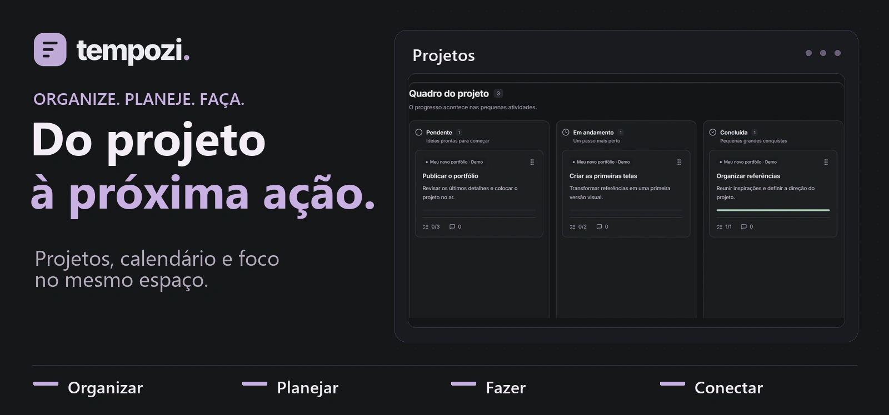

## 👋 Sobre mim

Sou **desenvolvedor júnior na DalPozzo**. Desenvolvo aplicações com OutSystems, Node.js e Vue.js, uso SQLite e faço integrações no Oracle, onde também escrevo procedures em PL/SQL.

Curso **Tecnologia em Sistemas para Internet na UTFPR**, com previsão de conclusão no fim de 2026. Como bolsista, contribuí para o SGTCC, sistema de gestão de trabalhos de conclusão de curso, usando Ruby on Rails e Vue.js. [Ver o SGTCC ↗](https://github.com/MarczalTSIGP/SGTCC)

> "Every bug has an explanation. Sometimes it's just hiding behind an `EXPLAIN PLAN`."

## ⏱️ Tempozi

**Do projeto à próxima ação.** Organize projetos em quadros, planeje entregas no calendário e coloque a próxima atividade em foco. O Tempozi também se conecta a agentes via MCP.

<a href="https://tempozi.com/">
  <picture>
    <source media="(prefers-reduced-motion: reduce)" srcset="./tempozi-capa.png">
    
  </picture>
</a>

[Abrir o Tempozi ↗](https://tempozi.com/)

## 💻 Stack

**Interfaces**

**APIs e bancos de dados**

**Plataformas e ferramentas**

## 📊 Atividade no GitHub

### 🏆 Troféus

---
<picture>
  <source media="(prefers-color-scheme: dark)" srcset="https://raw.githubusercontent.com/nicosikmoraes/nicosikmoraes/output/github-snake-dark.svg" />
  <source media="(prefers-color-scheme: light)" srcset="https://raw.githubusercontent.com/nicosikmoraes/nicosikmoraes/output/github-snake.svg" />
  
</picture>
